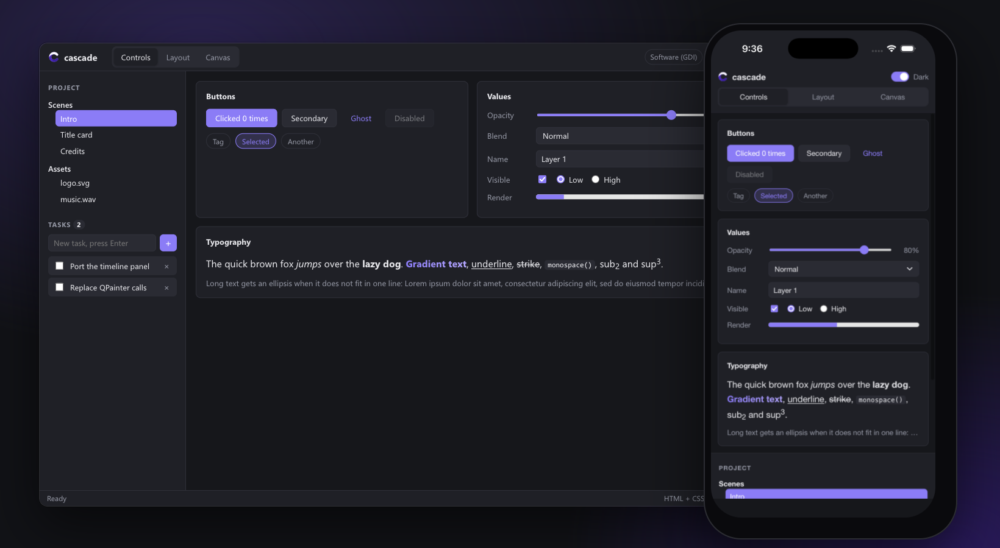
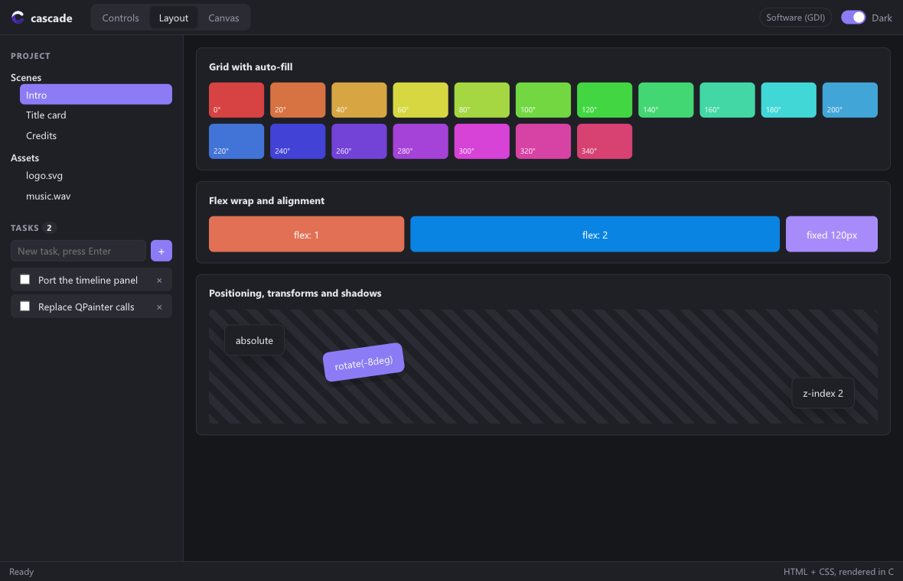
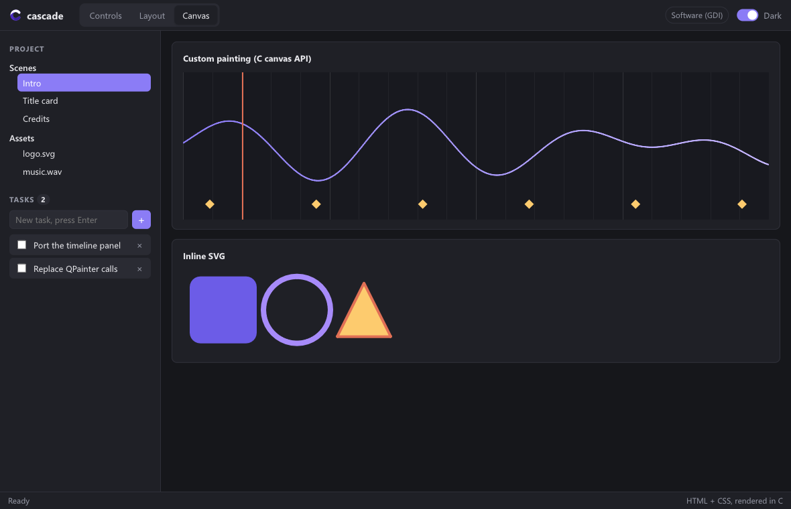
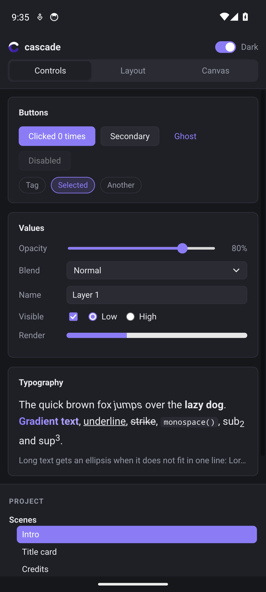

<div align="center">

<br>


<h1>cascade</h1>

<p><b>HTML and CSS. Written in C. Nothing else.</b></p>

<a href="https://github.com/eugeniobenfica/cascade/releases/tag/v1.0.0"></a>
<a href="LICENSE"></a>
<a href="docs/principles.md"></a>
<br>
<a href="https://github.com/eugeniobenfica/cascade/actions/workflows/windows.yml"></a>
<a href="https://github.com/eugeniobenfica/cascade/actions/workflows/linux.yml"></a>
<a href="https://github.com/eugeniobenfica/cascade/actions/workflows/macos.yml"></a>
<a href="https://github.com/eugeniobenfica/cascade/actions/workflows/android.yml"></a>
<a href="https://github.com/eugeniobenfica/cascade/actions/workflows/ios.yml"></a>
<a href="https://github.com/eugeniobenfica/cascade/actions/workflows/checks.yml"></a>
<a href="https://github.com/eugeniobenfica/cascade/actions/workflows/packages.yml"></a>
<a href="https://github.com/eugeniobenfica/cascade/actions/workflows/fuzz.yml"></a>

<p>
<a href="#quick-start">Quick start</a> &nbsp;·&nbsp;
<a href="#platforms">Platforms</a> &nbsp;·&nbsp;
<a href="#download">Download</a> &nbsp;·&nbsp;
<a href="#building">Building</a> &nbsp;·&nbsp;
<a href="#quality">Quality</a> &nbsp;·&nbsp;
<a href="#documentation">Documentation</a> &nbsp;·&nbsp;
<a href="CHANGELOG.md">Changelog</a>
</p>

</div>

<br>

cascade is a native UI engine. It reads an interface the way a browser reads a page, with HTML for
the structure and CSS for the look, and gives you the DOM in C. It runs the cascade, lays the page
out, paints it with its own anti-aliased rasterizer and shows it in a native window through Vulkan,
OpenGL or the system's software path.

There is no JavaScript. Your application is C, and it talks to the page through elements, events
and painters. Any language that calls C can do the same.

> **Made for** desktop and phone applications that want the web's way of laying things out without
> carrying a browser: tools, editors, panels, kiosks, images rendered on a server.<br>
> **Not a browser:** no JavaScript, no network loading, and pages are meant to be your own.
> [What is not there yet](docs/htmlAndCss.md#not-there-yet).

<div align="center">
<br>

<p><sub>The gallery, on a desktop and on a phone. This picture is a page too, rendered by <code>cascade-render</code>: <a href="docs/assets/src/hero.html">its source</a>.</sub></p>
</div>

## What is inside

| | |
| :--- | :--- |
| **CSS** | Selectors level 4, custom properties, `calc()`, `@media`, `@container`, `@keyframes`, transitions, nesting, `oklch()`, `color-mix()`, 3D transforms, `backdrop-filter`, masks |
| **Layout** | Block and inline flow, flexbox, grid with named areas and subgrid, tables, floats, sticky positioning, writing modes, bidirectional text |
| **Text** | OpenType shaping (Arabic, Indic), color and variable fonts, WOFF, the system's fonts, fallback |
| **Images** | PNG, JPEG (progressive), BMP, GIF and WebP, animated, lossy and lossless; inline SVG |
| **Painting** | Anti-aliased rasterizer on the CPU, large frames on several threads, repainting only what changed |
| **Your own drawing** | `cscdElementSetPainter` gives any element a 2D canvas: paths, gradients, images, text, shadows |
| **Native windows** | DPI scaling, input methods, clipboard, drag and drop, touch, the system's theme and text size |
| **Accessibility** | Roles, names, states and actions, offered to each platform's screen reader |
| **Applications** | Data binding, templates, lists of a hundred thousand rows, file dialogs, the macOS menu bar, a tray icon, an inspector (F12) |
| **Other languages** | C++ reads the headers as they are; a handle API with Python and Rust bindings for the rest |

<table>
  <tr>
    <td width="40%"></td>
    <td width="40%"></td>
    <td width="20%"></td>
  </tr>
  <tr>
    <td align="center"><sub>Grid, flexbox, positioning, transforms</sub></td>
    <td align="center"><sub>A painter in C, and inline SVG</sub></td>
    <td align="center"><sub>Android</sub></td>
  </tr>
</table>

## Quick start

**1. Link it.** From a downloaded SDK (its folder in `CMAKE_PREFIX_PATH`), from vcpkg, or from the
sources with `add_subdirectory(cascade)` in place of `find_package`.
[All the ways](docs/gettingStarted.md#add-it-to-a-project), pkg-config too.

```cmake
find_package(cascade 1 REQUIRED)
add_executable(my_app WIN32 main.c)
cascade_app(my_app UI ui)                 # links cascade and puts ui/ next to the program
```

**2. Write the interface.**

```html
<!-- ui/index.html -->
<link rel="stylesheet" href="app.css">
<main>
  <h1>Hello, cascade</h1>
  <button id="save" class="accent">Save</button>
  <p id="status">Nothing saved yet.</p>
  <div id="chart"></div>
</main>
```

```css
/* ui/app.css */
main   { max-width: 480px; margin: 40px auto; font-family: sans-serif; }
.accent { background: #8b5cf6; color: white; border: 0; border-radius: 6px; padding: 8px 16px; }
#chart { height: 120px; }                 /* a painter draws in the box the page gives it */
```

**3. Drive it from C.**

```c
#include "cascade/cascade.h"
#include "cascade/window.h"

static void onSave(void* user, CscdEvent* ev) {
    CscdView* ui = user;
    cscdElementSetText(cscdViewGet(ui, CSCD_SV("#status")), CSCD_SV("Saved."));
}

static void paintChart(void* user, CscdCanvas* c, float w, float h) {
    CscdPath wave = {0};
    cscdPathMoveTo(&wave, 0, h / 2);
    cscdPathCubicTo(&wave, w / 3, 0, w * 2 / 3, h, w, h / 2);
    cscdCanvasStrokePath(c, &wave, cscdRgb(139, 92, 246), 2);
    cscdPathFree(&wave);
}

int main(int argc, char** argv) {
    CscdWindowOptions opts = cscdWindowOptions();           /* Vulkan, then OpenGL, then software */
    opts.title = "My app";
    opts.page = "ui/index.html";                              /* found wherever the program starts from */
    CscdWindow* win = cscdWindowNew(&opts);
    CscdView* ui = cscdWindowView(win);

    cscdElementOnClick(cscdViewGet(ui, CSCD_SV("#save")), onSave, ui);
    CscdPainter chart = {paintChart, NULL, NULL};
    cscdElementSetPainter(cscdViewGet(ui, CSCD_SV("#chart")), chart);

    int code = cscdWindowRun(win);
    cscdWindowFree(win);
    return code;
}
```

The same `main` runs on every platform, phones included. In a debug build the program reads `ui/`
from your sources and reloads its CSS as you save it.

<details>
<summary><b>Rendering without a window</b>: tests, thumbnails, images on a server</summary>
<br>

```c
CscdView* view = cscdViewNew();
cscdViewLoadFile(view, CSCD_SV("card.html"));
cscdViewSetViewport(view, 1200, 630, 1);
CscdImage img;
cscdImageInit(&img, 1200, 630);
cscdViewPaint(view, &img, false);
cscdSavePNG(CSCD_SV("card.png"), &img);
cscdImageFini(&img);
cscdViewFree(view);
```

Build with `-DCASCADE_WINDOW=OFF` for the engine alone, or use `cascade-render page.html out.png`.
</details>

<details>
<summary><b>From other languages</b>: Python, Rust, C#, Go</summary>
<br>

`-DCASCADE_C_SHARED=ON` builds `cascade_c`, a shared library of [the handle API](docs/cApi.md):
element handles that fail cleanly once the element is gone instead of touching freed memory.
[Python](bindings/python/cascade.py) (standard library only) and [Rust](bindings/rust) bindings are
in the repository.

```python
import cascade
view = cascade.View()
view.load_html("<p id=p>Hello</p><button id=b>Go</button>")
view["#b"].on("click", lambda ev: view["#p"].set_text("Clicked"))
view["#b"].click()
print(view["#p"].text)            # Clicked
```
</details>

## Platforms

| | Window | Presenting | Screen readers | Support |
| :--- | :--- | :--- | :--- | :---: |
| **Windows** | Win32 | Vulkan, OpenGL, GDI | UI Automation | Tier 1 |
| **Linux** | Wayland or X11, at run time | Vulkan, OpenGL, shared memory | AT-SPI | Tier 1 |
| **macOS** | Cocoa | Vulkan (MoltenVK), OpenGL, Core Animation | NSAccessibility | Tier 1 |
| **iOS, iPadOS** | UIKit | Core Animation, 120 Hz | VoiceOver | Tier 2 |
| **Android** | cascade's activity (Java) | Vulkan, `ANativeWindow` | TalkBack | Tier 2 |

**Tier 1**: supported. Every change is built, tested and opened in a window on it.<br>
**Tier 2**: experimental. Built and tested by CI on a simulator and an emulator; Android also on
phones, by hand; iOS not yet on devices.<br>
The BSDs share Linux's module, but CI does not build on them.

Each platform is a module of its own in [`src/platform`](src/platform).
[Platforms](docs/platforms.md) says what each one does: input methods, the clipboard, drops, the
system's settings, the app's life.

## Download

| Platform | SDK | Try it |
| :--- | :--- | :--- |
| **Windows** x64 | [cascade-1.0.0-windows-x64.zip](https://github.com/eugeniobenfica/cascade/releases/download/v1.0.0/cascade-1.0.0-windows-x64.zip) | [Gallery](https://github.com/eugeniobenfica/cascade/releases/download/v1.0.0/cascade-gallery-1.0.0-windows-x64.zip) |
| **Linux** x64 | [cascade-1.0.0-linux-x64.tar.gz](https://github.com/eugeniobenfica/cascade/releases/download/v1.0.0/cascade-1.0.0-linux-x64.tar.gz) | [Gallery](https://github.com/eugeniobenfica/cascade/releases/download/v1.0.0/cascade-gallery-1.0.0-linux-x64.tar.gz) |
| **macOS** Apple silicon, Intel | [cascade-1.0.0-macos-universal.tar.gz](https://github.com/eugeniobenfica/cascade/releases/download/v1.0.0/cascade-1.0.0-macos-universal.tar.gz) | [Gallery](https://github.com/eugeniobenfica/cascade/releases/download/v1.0.0/cascade-gallery-1.0.0-macos-universal.zip) |
| **Android** arm64, armv7, x86_64 | [cascade-1.0.0-android.zip](https://github.com/eugeniobenfica/cascade/releases/download/v1.0.0/cascade-1.0.0-android.zip) | [Gallery APK](https://github.com/eugeniobenfica/cascade/releases/download/v1.0.0/cascade-gallery-1.0.0.apk) |
| **iOS** devices, simulator | [cascade-1.0.0-ios.zip](https://github.com/eugeniobenfica/cascade/releases/download/v1.0.0/cascade-1.0.0-ios.zip) (XCFramework) | |

Each SDK holds the library, its headers and a CMake package. Checksums are in each release's
`SHA256SUMS.txt`. [All releases](https://github.com/eugeniobenfica/cascade/releases).

## Building

```bash
cmake -S . -B build -G Ninja
cmake --build build
ctest --test-dir build                 # the tests, the handle API's, the window's and the stress run
./build/cascade-gallery                # the gallery, with --vulkan, --opengl or --software
cmake --install build --prefix sdk     # the library, its headers and its CMake package
```

A C11 compiler and CMake 3.16 are all it takes: MinGW-w64, MSVC, GCC or Clang. On Linux, X11 needs
the Xlib headers (`libx11-dev`, `libX11-devel`); Wayland needs nothing to build. Phones:
[iOS and Android](docs/platforms.md#ios-and-android).

To vendor only what your platforms need, with no iOS or Android code in a desktop app:
`cmake -DPLATFORMS=desktop -DOUT=third_party/cascade -P tools/slim.cmake`.
See [Only your platforms](docs/gettingStarted.md#only-your-platforms).

<details>
<summary><b>Build options</b></summary>
<br>

| Option | Default | |
| --- | :---: | --- |
| `CASCADE_WINDOW` | `ON` | the native window; off, the engine alone |
| `CASCADE_VULKAN`, `CASCADE_OPENGL` | `ON` | those presenters (the system's software path is always there) |
| `CASCADE_ACCESSIBILITY` | `ON` | the bridges to the platform's screen readers |
| `CASCADE_C_SHARED` | `OFF` | `cascade_c`, the handle API as a shared library for other languages |
| `CASCADE_BUILD_TESTS`, `_TOOLS`, `_EXAMPLES` | desktops | the tests, `cascade-render` and the gallery |
| `CASCADE_INSTALL` | `ON` | `cmake --install` rules (with `cascade.pc` for pkg-config) |
| `CASCADE_SANITIZE`, `CASCADE_FUZZ` | off | sanitizers (`address,undefined,float-cast-overflow`), and the `cascade-fuzz-*` programs |
| `CASCADE_TARGET` | `cascade` | the library target's name, for projects that already have one called that |
</details>

<details>
<summary><b>What is where</b></summary>
<br>

```
include/cascade/        the public API: cascade.h, window.h, view.h, dom.h, canvas.h, cascadeC.h…
src/                    the engine, a folder per part: core/ dom/ style/ layout/ text/ image/ paint/ view/ capi/
src/platform/
├── common/             what every window shares: the frame, the presenter's choice, posting
├── gpu/                the Vulkan and OpenGL presenters
└── windows/ linux/ macos/ ios/ android/      one module per platform, with its platform.cmake
cmake/                  cascade_app(), the package find_package(cascade) finds, cascade.pc
packaging/              the vcpkg port
bindings/               Python and Rust
examples/               the gallery, and how to package it for iOS and Android
tests/                  the tests, the stress program, the fuzz targets and what crashed them before
tools/                  cascade-render, slim.cmake and the generators of the Unicode tables and fixtures
docs/
```

Files are named in camelCase (`viewInternal.h`, `windowWin32.c`), like the functions in them;
[Conventions](docs/conventions.md#names) has the exceptions.
</details>

## Quality

CI builds and tests every platform on every change. On top of the ordinary tests:

- **The same pixels, proved.** `cascade-tests` paints seven pages at four scales, on one thread and
  on four, and compares their hashes with [the same list](tests/pixelsExpected.inc) on every platform.
- **Sanitizers.** The tests also run under AddressSanitizer and UndefinedBehaviorSanitizer.
- **Fuzzers.** libFuzzer feeds the HTML and CSS parsers, the image and font decoders and zlib, and
  then clicks, types in and reads the pages it made: a minute of each on every change, and half an
  hour of each every night.
- **Stress.** `cascade-stress` sends random changes and input to a page while its listeners remove
  elements and replace the page, for the sanitizers to watch.

**Pages from elsewhere.** Decoders and parsers are written for damaged and hostile files, and a
page cannot run code. A page can still name any file the program may read, and running out of
memory ends the program ([Errors](docs/conventions.md#errors)). There is no sandbox: to show content
you do not trust, serve it through your own loader (`cscdAppSetResourceLoader`) and keep it away
from your files.

## Principles

- **Nothing in for convenience.** cascade writes what it needs: the parser, the cascade, the
  layout, text shaping, the image decoders, the rasterizer. It links no third-party library on any
  platform, only what each system provides: on Android, the SDK and the NDK, with no Jetpack or Play
  services. A library comes in only when a platform offers a capability through it and nothing
  else, and then it stays in that platform's module.
- **The same pixels everywhere.** One rasterizer paints every frame on every platform; the GPU
  presents. The tests hold every platform to the same hashes of the same pages.
- **The web's names, C's ways.** Pages are plain HTML and CSS; the API around them is plain C,
  written [one way](docs/conventions.md).
- **Versions that mean something.** [Semantic Versioning](https://semver.org): a program written for
  1.x compiles against every 1.x. It can ask which it has with `CSCD_VERSION_MAJOR`, `_MINOR` and
  `_PATCH` when it compiles, `cscd_version()` when it runs, or `find_package(cascade 1)` in CMake.
  The shared library's name carries the major version (`libcascade_c.so.1`).

More in [Principles](docs/principles.md).

## Documentation

| | |
| :--- | :--- |
| [Getting started](docs/gettingStarted.md) | Build it, add it to a project, the first window, rendering without one. |
| [Conventions](docs/conventions.md) | How the C API is written: names, strings, vectors, ownership, callbacks. |
| [HTML and CSS](docs/htmlAndCss.md) | What the parser, the cascade and the layout support, and what they do not yet. |
| [The interface](docs/interface.md) | Events, forms, menus, dialogs, popovers, touch, phones' keyboards, the app's life, threads. |
| [Drawing](docs/drawing.md) | Painters, the canvas API, images and fonts, bringing in other renderers. |
| [Rendering and performance](docs/rendering.md) | The pipeline, what repaints when, and how to keep frames fast. |
| [Platforms](docs/platforms.md) | Each platform's window, presenters, input, clipboard, screen readers and settings. |
| [Porting from Qt / Skia](docs/porting.md) | Moving a Qt Widgets application over, concept by concept. |
| [The handle API](docs/cApi.md) | `cascadeC.h`: handles that cannot dangle and a stable ABI, for Python, Rust, C#, Go. |
| [Principles](docs/principles.md) | What goes in and what does not: dependencies, pixels, platforms, versions. |
| [Rasterizing on the GPU](docs/gpuRasterization.md) | A study: the GPU painting frames, with the same pixels everywhere. |

## License

MIT. See [LICENSE](LICENSE).
