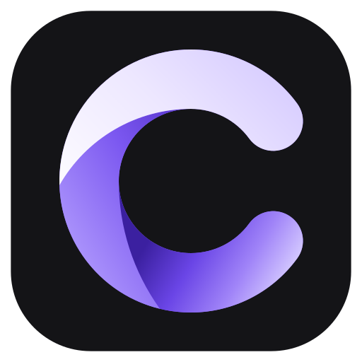
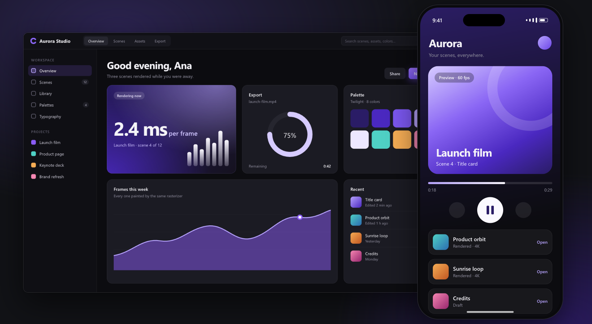
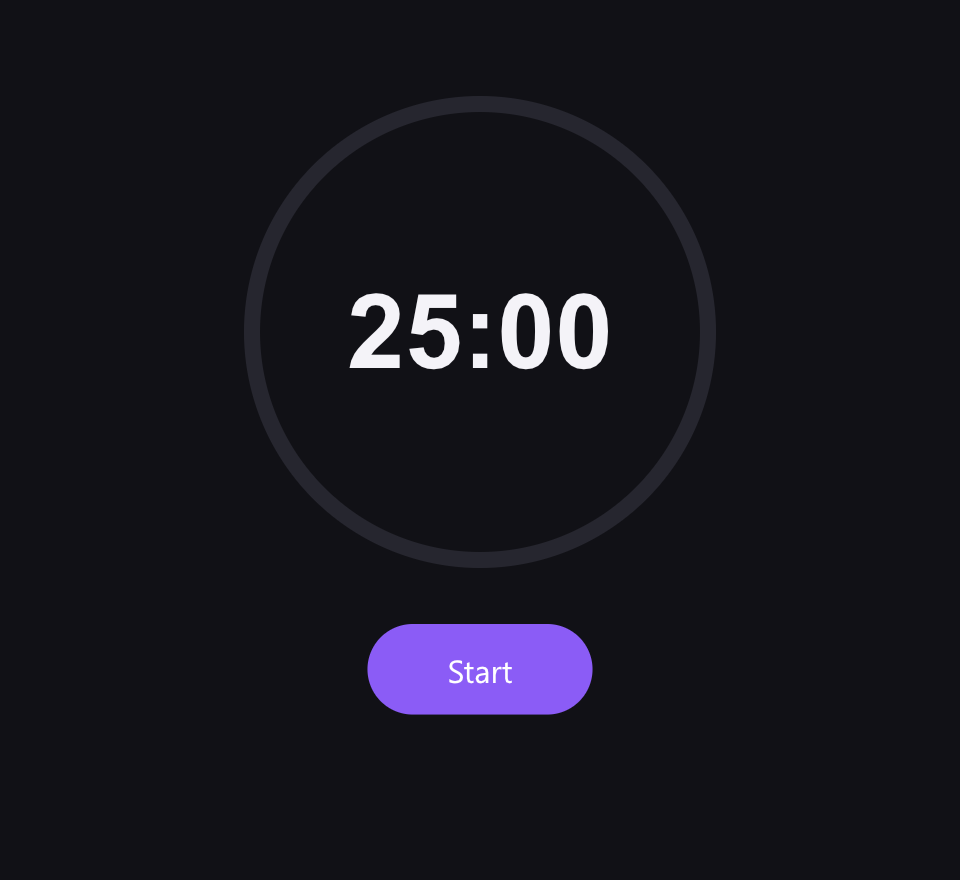
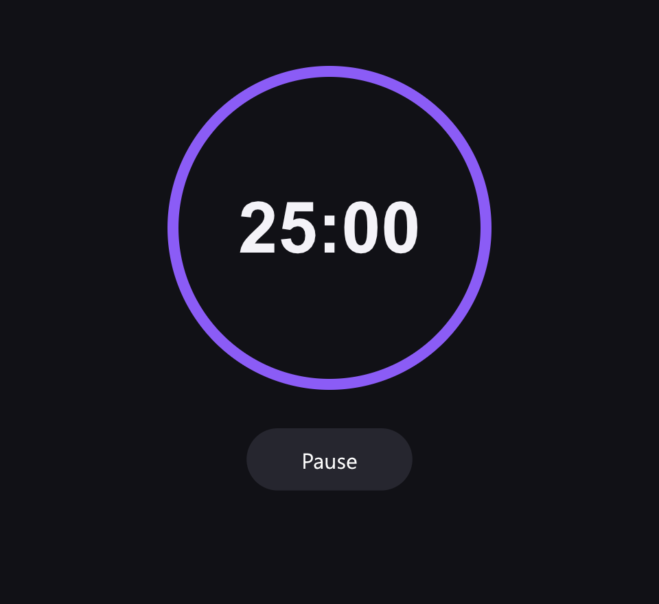
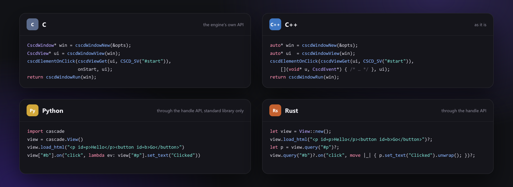

<div align="center">

<br>



<h1>cascade</h1>

<p><b>HTML and CSS. Written in C. Nothing else.</b></p>

<a href="https://github.com/eugeniobenfica/cascade/releases/tag/v1.0.0"></a>
<a href="LICENSE"></a>
<a href="docs/principles.md"></a>
<br>
<a href="https://github.com/eugeniobenfica/cascade/actions/workflows/windows.yml"></a>
<a href="https://github.com/eugeniobenfica/cascade/actions/workflows/linux.yml"></a>
<a href="https://github.com/eugeniobenfica/cascade/actions/workflows/macos.yml"></a>
<a href="https://github.com/eugeniobenfica/cascade/actions/workflows/android.yml"></a>
<a href="https://github.com/eugeniobenfica/cascade/actions/workflows/ios.yml"></a>

<p>
<a href="#the-idea">The idea</a> &nbsp;·&nbsp;
<a href="#quick-start">Quick start</a> &nbsp;·&nbsp;
<a href="#documentation">Documentation</a> &nbsp;·&nbsp;
<a href="CHANGELOG.md">Changelog</a>
</p>

</div>

<br>

cascade is a native UI engine: you write the interface in HTML and CSS and drive it from C. It lays
the page out, paints it with its own rasterizer and shows it in a native window, on Windows, Linux,
macOS, iOS and Android. There is no JavaScript; your program talks to the page through elements,
events and painters.

> **Made for** applications that want the web's layout without a browser: tools, editors, panels, kiosks, images rendered on a server.<br>
> **Not a browser:** no JavaScript, no network loading. [What is not there yet](docs/htmlAndCss.md#not-there-yet).

<div align="center">
<br>

<p><sub>An example app on a desktop and a phone, drawn by cascade itself (<a href="docs/assets/src/hero.html">source</a>).</sub></p>
</div>

## The idea

<table>
<tr>
<td width="33%" valign="top">

**HTML and CSS.**<br>
Pages are written as for a browser: the same HTML, the same CSS, the same events. What you know
about the web applies, and the API around it is plain C.

</td>
<td width="33%" valign="top">

**Written in C.**<br>
One rasterizer paints every frame, the same way on every platform; the GPU only presents. A page
looks the same on Windows, a Mac and a phone, and the tests prove it pixel by pixel.

</td>
<td width="33%" valign="top">

**Nothing else.**<br>
The parser, the layout, the shaping, the decoders: all written here. A library comes in only when a
platform offers something through it and nothing else. Today, there is none.

</td>
</tr>
</table>

<p align="right"><sub><a href="docs/principles.md">The principles in full →</a></sub></p>

## What is inside

| | |
| :--- | :--- |
| **CSS** | Selectors 4, custom properties, `calc()`, `@media`, `@container`, animations, transitions, nesting, 3D transforms |
| **Layout** | Flow, flexbox, grid with subgrid, tables, floats, sticky, writing modes, bidirectional text |
| **Text** | OpenType shaping, color and variable fonts, WOFF, the system's fonts |
| **Images** | PNG, JPEG, BMP, GIF and WebP (animated too), inline SVG |
| **Drawing** | A 2D canvas in any element, from C: paths, gradients, images, text, shadows |
| **Platform** | Native windows, input methods, clipboard, drag and drop, touch, screen readers |
| **Other languages** | C++ as it is; Python and Rust through a handle API |

## Quick start

**1. Link it** ([other ways](docs/gettingStarted.md#add-it-to-a-project): vcpkg, pkg-config, the sources).

```cmake
find_package(cascade 1 REQUIRED)
add_executable(my_app WIN32 main.c)
cascade_app(my_app UI ui)                 # links cascade and puts ui/ next to the program
```

**2. Write the interface.**

```html
<!-- ui/index.html -->
<link rel="stylesheet" href="app.css">
<main class="timer">
  <div class="ring"><h1>25:00</h1></div>
  <button id="start">Start</button>
</main>
```

```css
/* ui/app.css */
body   { margin: 0; background: #111116; color: #f4f3f8; font-family: sans-serif; }
.timer { display: grid; place-items: center; gap: 28px; padding: 48px; }
.ring  { width: 220px; aspect-ratio: 1; border-radius: 50%; border: 8px solid #26262f;
         display: grid; place-items: center; }
.ring h1 { margin: 0; font-size: 52px; }
#start { background: #8b5cf6; color: white; border: 0; border-radius: 999px;
         padding: 12px 40px; font-size: 16px; }
.running .ring  { border-color: #8b5cf6; }          /* main.c switches this class */
.running #start { background: #26262f; }
```

**3. Drive it from C.**

```c
#include "cascade/cascade.h"
#include "cascade/window.h"

static void onStart(void* user, CscdEvent* ev) {
    CscdView* ui = user;
    bool running = cscdElementToggleClass(cscdViewGet(ui, CSCD_SV(".timer")), CSCD_SV("running"));
    cscdElementSetText(cscdViewGet(ui, CSCD_SV("#start")), running ? CSCD_SV("Pause") : CSCD_SV("Start"));
}

int main(int argc, char** argv) {
    CscdWindowOptions opts = cscdWindowOptions();           /* Vulkan, then OpenGL, then software */
    opts.title = "Focus";
    opts.page = "ui/index.html";                              /* found wherever the program starts from */
    CscdWindow* win = cscdWindowNew(&opts);
    CscdView* ui = cscdWindowView(win);

    cscdElementOnClick(cscdViewGet(ui, CSCD_SV("#start")), onStart, ui);

    int code = cscdWindowRun(win);
    cscdWindowFree(win);
    return code;
}
```

<div align="center">


<p><sub>What the window shows, before and after a click on Start (<a href="docs/assets/src/quickStart.c">how these pictures are made</a>). The same <code>main</code> runs on every platform, phones included; to draw in an element yourself, give it a <a href="docs/drawing.md">painter</a>.</sub></p>
</div>

**4. Change the look while it runs.** In debug builds a window reads its style sheets again when they
change on disk ([live reload](docs/gettingStarted.md#live-reload)): give the timer another color in
`app.css`, save, and the window shows it, still running.

<details>
<summary><b>Without a window</b>: tests, thumbnails, images on a server</summary>
<br>

```c
CscdView* view = cscdViewNew();
cscdViewLoadFile(view, CSCD_SV("card.html"));
cscdViewSetViewport(view, 1200, 630, 1);
CscdImage img;
cscdImageInit(&img, 1200, 630);
cscdViewPaint(view, &img, false);
cscdSavePNG(CSCD_SV("card.png"), &img);
cscdImageFini(&img);
cscdViewFree(view);
```

Build with `-DCASCADE_WINDOW=OFF` for the engine alone, or use `cascade-render page.html out.png`.
</details>

<details>
<summary><b>From other languages</b>: Python, Rust, C#, Go</summary>
<br>

`-DCASCADE_C_SHARED=ON` builds `cascade_c`, a shared library of [the handle API](docs/cApi.md):
element handles that fail cleanly once the element is gone. [Python](bindings/python/cascade.py) and
[Rust](bindings/rust) bindings are in the repository.

```python
import cascade
view = cascade.View()
view.load_html("<p id=p>Hello</p><button id=b>Go</button>")
view["#b"].on("click", lambda ev: view["#p"].set_text("Clicked"))
view["#b"].click()
print(view["#p"].text)            # Clicked
```

<div align="center">

<p><sub>C and C++ call the engine as it is; Python and Rust go through the handle API (<a href="docs/assets/src/languages.html">how this picture is made</a>).</sub></p>
</div>
</details>

## Platforms

| | Window | Presenting | Screen readers | Support |
| :--- | :--- | :--- | :--- | :---: |
| **Windows** | Win32 | Vulkan, OpenGL, GDI | UI Automation | Tier 1 |
| **Linux** | Wayland or X11 | Vulkan, OpenGL, shared memory | AT-SPI | Tier 1 |
| **macOS** | Cocoa | Vulkan (MoltenVK), OpenGL, Core Animation | NSAccessibility | Tier 1 |
| **iOS, iPadOS** | UIKit | Core Animation | VoiceOver | Tier 2 |
| **Android** | cascade's activity | Vulkan, `ANativeWindow` | TalkBack | Tier 2 |

**Tier 1**: every change is built, tested and opened in a window on it. **Tier 2**: built and tested
by CI on a simulator and an emulator; Android also by hand on phones, iOS not yet on devices.
[Platforms](docs/platforms.md) has the details.

## Download

| Platform | SDK | Try it |
| :--- | :--- | :--- |
| **Windows** x64 | [cascade-1.0.0-windows-x64.zip](https://github.com/eugeniobenfica/cascade/releases/download/v1.0.0/cascade-1.0.0-windows-x64.zip) | [Gallery](https://github.com/eugeniobenfica/cascade/releases/download/v1.0.0/cascade-gallery-1.0.0-windows-x64.zip) |
| **Linux** x64 | [cascade-1.0.0-linux-x64.tar.gz](https://github.com/eugeniobenfica/cascade/releases/download/v1.0.0/cascade-1.0.0-linux-x64.tar.gz) | [Gallery](https://github.com/eugeniobenfica/cascade/releases/download/v1.0.0/cascade-gallery-1.0.0-linux-x64.tar.gz) |
| **macOS** Apple silicon, Intel | [cascade-1.0.0-macos-universal.tar.gz](https://github.com/eugeniobenfica/cascade/releases/download/v1.0.0/cascade-1.0.0-macos-universal.tar.gz) | [Gallery](https://github.com/eugeniobenfica/cascade/releases/download/v1.0.0/cascade-gallery-1.0.0-macos-universal.zip) |
| **Android** arm64, armv7, x86_64 | [cascade-1.0.0-android.zip](https://github.com/eugeniobenfica/cascade/releases/download/v1.0.0/cascade-1.0.0-android.zip) | [Gallery APK](https://github.com/eugeniobenfica/cascade/releases/download/v1.0.0/cascade-gallery-1.0.0.apk) |
| **iOS** devices, simulator | [cascade-1.0.0-ios.zip](https://github.com/eugeniobenfica/cascade/releases/download/v1.0.0/cascade-1.0.0-ios.zip) (XCFramework) | |

Each SDK holds the library, its headers and a CMake package; checksums are in `SHA256SUMS.txt`.

## Building

```bash
cmake -S . -B build -G Ninja
cmake --build build
ctest --test-dir build
```

A C11 compiler and CMake 3.16: MinGW-w64, MSVC, GCC or Clang. X11 on Linux needs the Xlib headers;
phones: [iOS and Android](docs/platforms.md#ios-and-android).

<details>
<summary><b>Build options</b></summary>
<br>

| Option | Default | |
| --- | :---: | --- |
| `CASCADE_WINDOW` | `ON` | the native window; off, the engine alone |
| `CASCADE_VULKAN`, `CASCADE_OPENGL` | `ON` | those presenters (the system's software path is always there) |
| `CASCADE_ACCESSIBILITY` | `ON` | the bridges to the platform's screen readers |
| `CASCADE_C_SHARED` | `OFF` | `cascade_c`, the handle API as a shared library for other languages |
| `CASCADE_BUILD_TESTS`, `_TOOLS`, `_EXAMPLES` | desktops | the tests, `cascade-render` and the gallery (`build/cascade-gallery`) |
| `CASCADE_INSTALL` | `ON` | `cmake --install` rules (with `cascade.pc` for pkg-config) |
| `CASCADE_SANITIZE`, `CASCADE_FUZZ` | off | sanitizers, and the `cascade-fuzz-*` programs |
| `CASCADE_TARGET` | `cascade` | the library target's name, for projects that already have one called that |

To vendor only your platforms' code: `cmake -DPLATFORMS=desktop -DOUT=third_party/cascade -P tools/slim.cmake`
([Only your platforms](docs/gettingStarted.md#only-your-platforms)).
</details>

<details>
<summary><b>What is where</b></summary>
<br>

```
include/cascade/   the public API: cascade.h, window.h, view.h, dom.h, canvas.h, cascadeC.h…
src/               the engine, a folder per part, and src/platform/ with one module per platform
cmake/             cascade_app() and the package find_package(cascade) finds
bindings/          Python and Rust
examples/          the gallery, and how to package it for iOS and Android
tests/             the tests, the stress program, the fuzz targets and what crashed them before
tools/             cascade-render, slim.cmake and the generators of the Unicode tables
```
</details>

## Quality

- **Pixels, proved.** The tests paint [seven pages](tests/pixelsExpected.inc) at four scales and compare the same hashes on every platform.
- **Sanitizers and fuzzers.** The tests run under AddressSanitizer and UndefinedBehaviorSanitizer; libFuzzer feeds the parsers and decoders on every change and for half an hour every night.
- **Hostile files.** Decoders and parsers expect damaged input, and a page cannot run code. There is no sandbox, though: a page can name any file the program may read, so serve content you do not trust through your own loader (`cscdAppSetResourceLoader`).

## Documentation

| | |
| :--- | :--- |
| [Getting started](docs/gettingStarted.md) | Build it, add it to a project, the first window. |
| [HTML and CSS](docs/htmlAndCss.md) | What is supported, and what is not yet. |
| [The interface](docs/interface.md) | Events, forms, menus, dialogs, touch, threads. |
| [Drawing](docs/drawing.md) | Painters, the canvas, images and fonts. |
| [Rendering](docs/rendering.md) | The pipeline, and keeping frames fast. |
| [Platforms](docs/platforms.md) | Each platform's window, input and screen readers. |
| [Conventions](docs/conventions.md) | How the C API is written. |
| [The handle API](docs/cApi.md) | `cascadeC.h`, for Python, Rust, C#, Go. |
| [Porting from Qt / Skia](docs/porting.md) | Moving a Qt Widgets application over. |
| [Principles](docs/principles.md) | What goes in and what does not. |

## License

MIT. See [LICENSE](LICENSE).

<div align="center">

<p><sub><b>HTML and CSS. Written in C. Nothing else.</b></sub></p>
</div>
